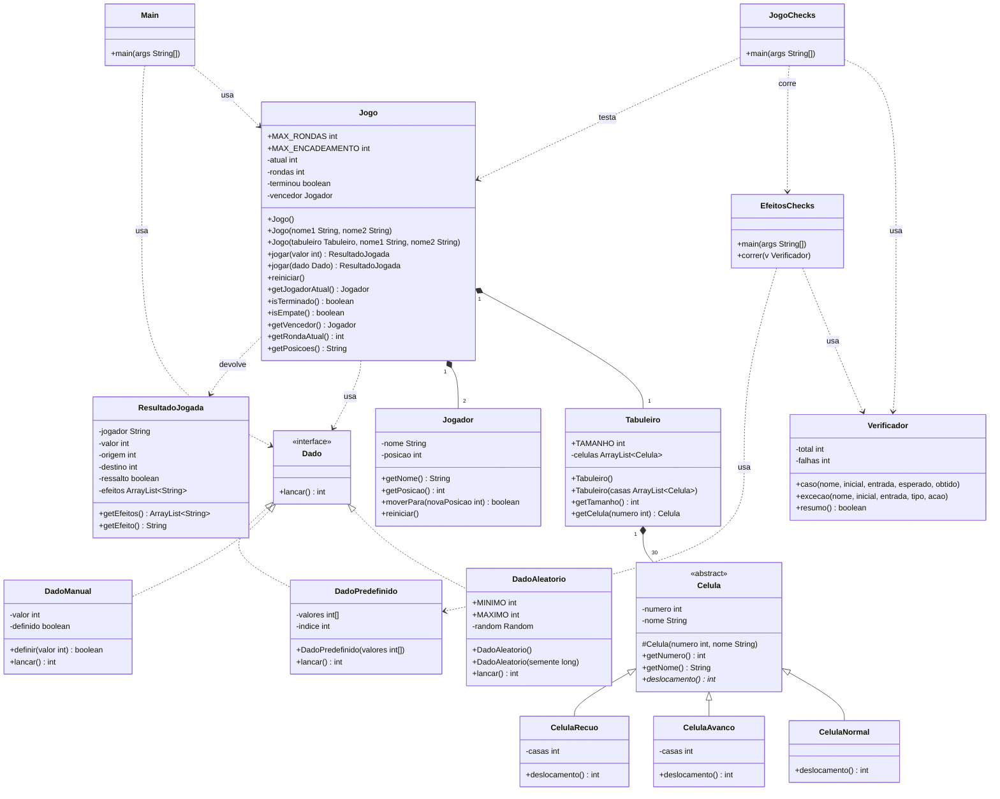

# UML - Metro de Lisboa (marco de novembro)

## Notas

- `Dado` é uma interface: o jogo aceita qualquer fonte de valores (aleatória agora; manual e com valores predefinidos nos testes, em novembro).
- `Celula` é abstrata e `deslocamento()` é redefinido em cada subclasse (herança e polimorfismo).
- `Jogo` contém as regras e não escreve nada no ecrã. Toda a interação com o utilizador está em `Main` (consola separada das regras).
- Sobrecargas: `DadoAleatorio()` / `DadoAleatorio(long)`, `Tabuleiro()` / `Tabuleiro(ArrayList<Celula>)`, `Jogo()` / `Jogo(String, String)` / `Jogo(Tabuleiro, String, String)` e `jogar(int)` / `jogar(Dado)`.
- `DadoManual` valida o valor (1 a 6) em `definir`; um valor inválido devolve `false` e não altera nada. `DadoPredefinido` devolve uma sequência fixa e é usado nos testes.
- O tabuleiro com casas à escolha só é usado nos testes, para provar que o encadeamento pára ao fim de 5 passos (o mapa real não tem ciclos).
- `Tabuleiro "1" *-- "30" Celula` refere-se ao tabuleiro do jogo; o de teste pode ter outro tamanho.
