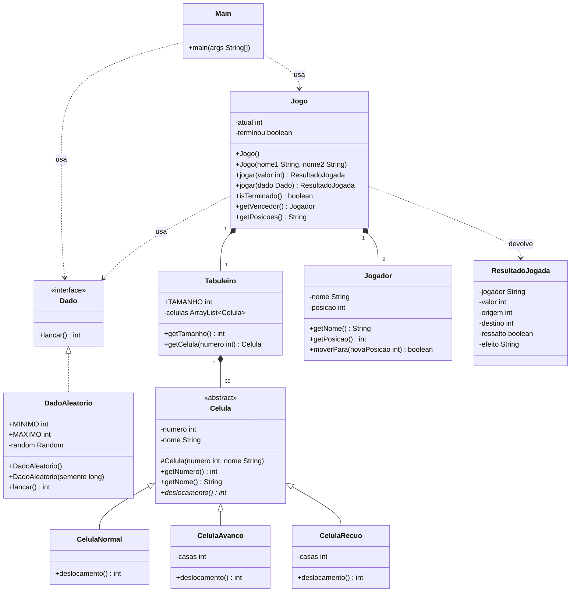

# UML inicial - Metro de Lisboa

## Notas

- `Dado` é uma interface: o jogo aceita qualquer fonte de valores (aleatória agora; manual e com valores predefinidos nos testes, em novembro).
- `Celula` é abstrata e `deslocamento()` é redefinido em cada subclasse (herança e polimorfismo).
- `Jogo` contém as regras e não escreve nada no ecrã. Toda a interação com o utilizador está em `Main` (consola separada das regras).
- Sobrecargas: `DadoAleatorio()` / `DadoAleatorio(long)`, `Jogo()` / `Jogo(String, String)` e `jogar(int)` / `jogar(Dado)`.
